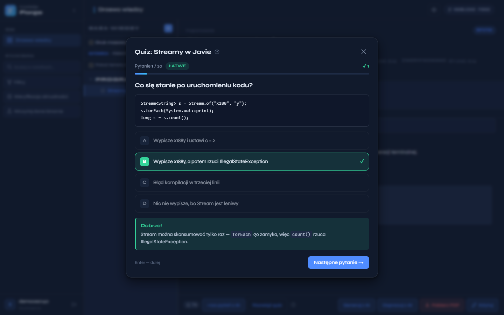
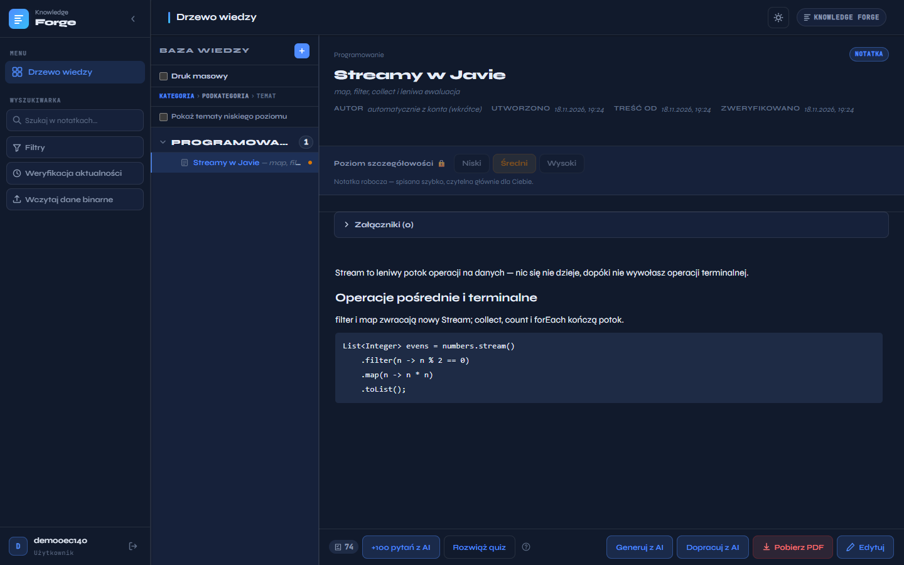
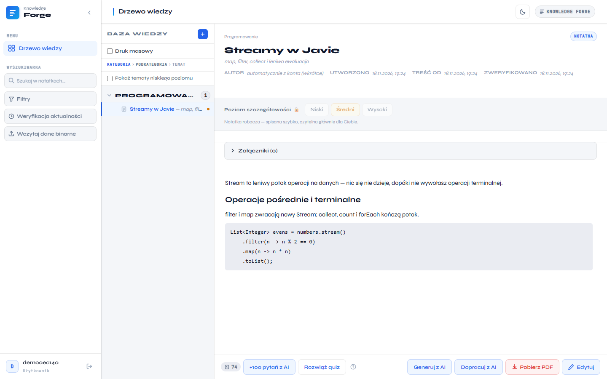
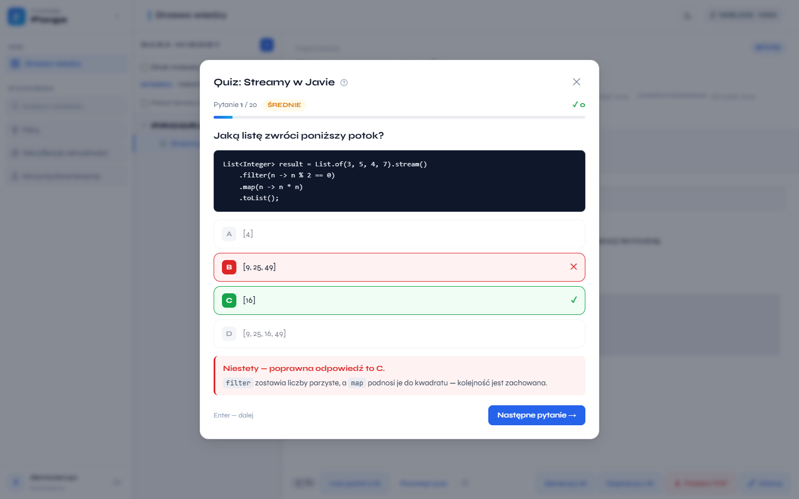
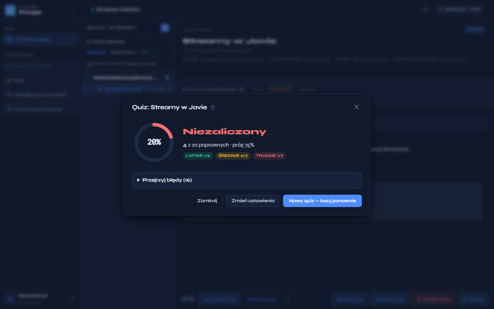
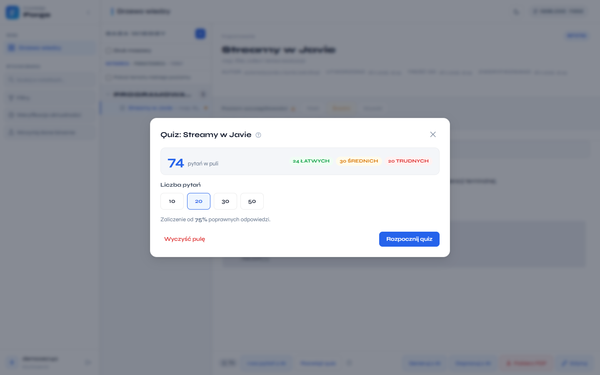
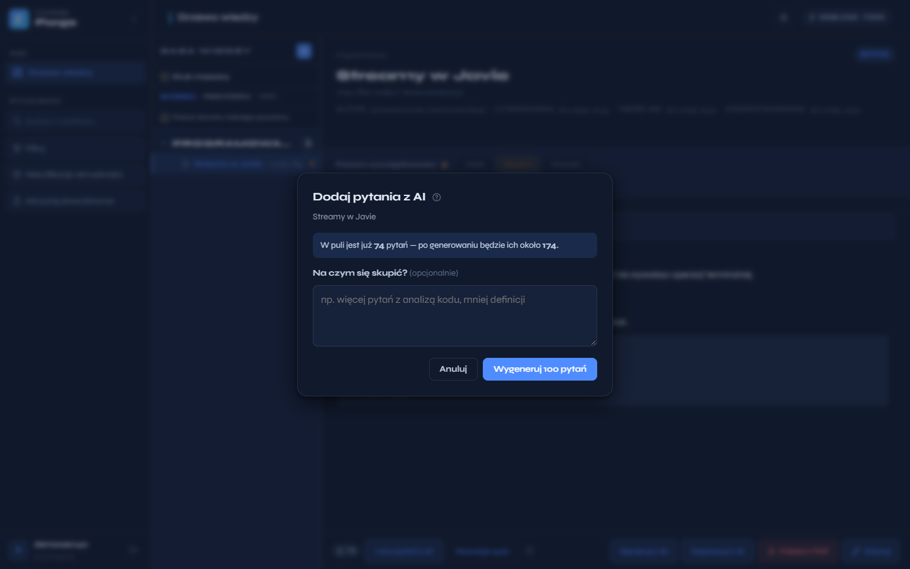
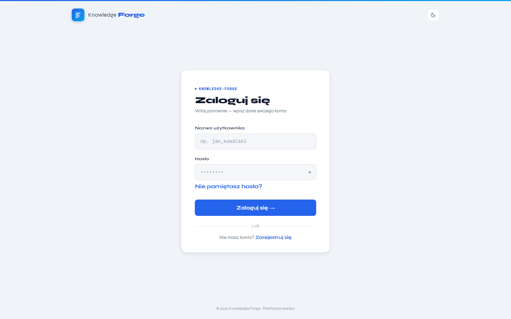
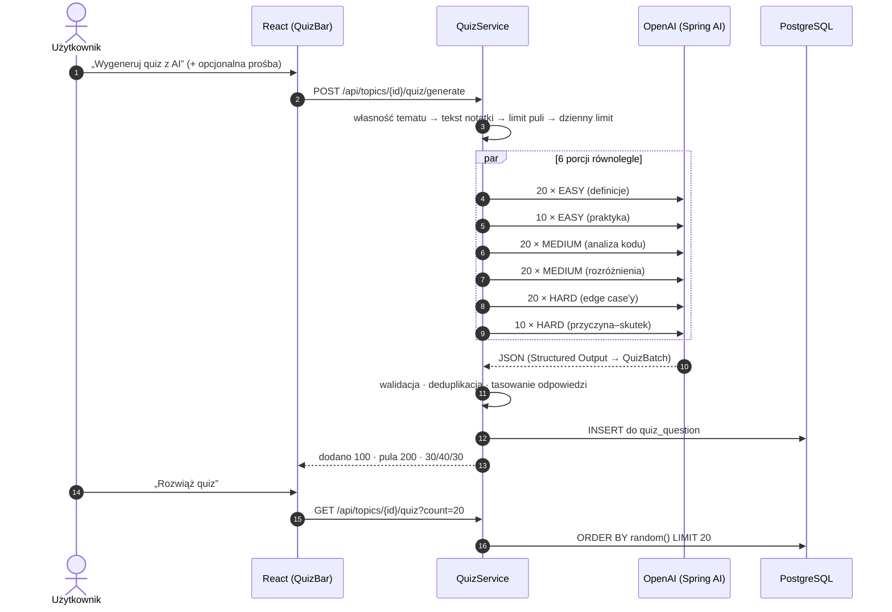
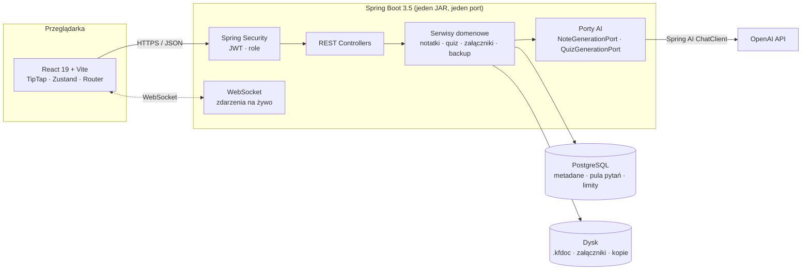

<div align="center">

# Knowledge Forge

**Twoja prywatna kuźnia wiedzy: notatki, które AI pomaga napisać, i quizy, które sprawdzają, czy naprawdę rozumiesz.**

Porządkujesz wiedzę w drzewie kategorii, piszesz notatki w edytorze z kodem i obrazkami, a jednym kliknięciem<br/>
zamieniasz notatkę w pulę **100 merytorycznych pytań A–D**. Każdy quiz losuje zestaw od nowa.




</div>

---

## Spis treści

- [Dlaczego Knowledge Forge?](#dlaczego-knowledge-forge)
- [Funkcje](#funkcje)
- [Zrzuty ekranu](#zrzuty-ekranu)
- [Jak działa quiz z AI](#jak-działa-quiz-z-ai)
- [Architektura](#architektura)
- [Stos technologiczny](#stos-technologiczny)
- [Szybki start](#szybki-start)
- [Konfiguracja](#konfiguracja)
- [Testy i jakość](#testy-i-jakość)
- [API](#api)
- [Struktura projektu](#struktura-projektu)
- [Dokumentacja szczegółowa](#dokumentacja-szczegółowa)

---

## Dlaczego Knowledge Forge?

Notatki zwykle kończą jako cmentarzysko: zapisane raz, nigdy nie powtórzone. Knowledge Forge zamyka tę pętlę:

1. **Piszesz notatkę albo każesz AI przygotować szkic.** Dostajesz streszczenie, sekcje, trzy przykłady na różnych poziomach, typowe błędy i rzeczy do zapamiętania.
2. **Dopracowujesz ją z AI własnymi słowami**, np. „rozwiń warunek stopu i dodaj przykład z kodem”.
3. **Generujesz quiz.** AI czyta notatkę i układa 100 pytań: łatwe, średnie i trudne, a przy tematach technicznych część z nich zawiera kod do analizy.
4. **Rozwiązujesz quizy aż do zaliczenia (75%).** Każde podejście to nowe losowanie z całej puli, po każdej odpowiedzi od razu widzisz wyjaśnienie. Gdy pytania się znudzą, dorzucasz kolejne 100.

Do tego dochodzi wszystko, czego oczekujesz od dojrzałej aplikacji: konta i uprawnienia, synchronizacja na żywo między kartami, eksport do PDF, załączniki, kopie zapasowe i tryb ciemny.

---

## Funkcje

### 🧠 AI, które uczy, a nie tylko pisze
| | |
|---|---|
| **Wygeneruj notatkę z AI** | Szkic według poziomu (podstawowy / średni / zaawansowany) i Twoich wytycznych: streszczenie, wyjaśnienie „dla 8-latka”, sekcje, 3 przykłady (intuicja, kontrast, edge case), typowe błędy, punkty do zapamiętania, frazy do dalszego szukania. |
| **Dopracuj z AI** | Wysyłasz bieżący tekst i prośbę, a dostajesz poprawiony szkic. Nic nie zapisuje się samo: najpierw przeglądasz zmiany. |
| **Wygeneruj quiz z AI** | 100 pytań A–D w proporcji 30 / 40 / 30 (łatwe / średnie / trudne), generowanych **równolegle w 6 porcjach**, każda z inną perspektywą (definicje, praktyka, analiza kodu, rozróżnienia, edge case'y, przyczyna–skutek). |
| **Pula, która rośnie** | Kolejne kliknięcie dorzuca następne 100 pytań. Duplikaty względem puli są odrzucane, a skromny licznik w panelu notatki pokazuje jej rozmiar. |
| **Quiz** | Losowanie z całej puli (10 / 20 / 30 / 50 pytań), obsługa klawiaturą (1–4, A–D, Enter), wyjaśnienie po każdej odpowiedzi, wynik z podziałem na poziomy i przegląd błędów. Zaliczenie od **75%**. |
| **Instrukcja pod ręką** | Subtelna ikonka „?” przy każdej funkcji AI, z dwoma–trzema zdaniami objaśnienia zamiast elaboratu. |

### 📚 Baza wiedzy
- **Drzewo kategorii** o dowolnej głębokości, a w nim wpisy typu *notatka* lub *instrukcja* z poziomem dopracowania (szkic, roboczy, dopracowany).
- **Edytor WYSIWYG (TipTap)** z blokami kodu, listami, cytatami i obrazkami wklejanymi prosto ze schowka.
- **Własny format `.kfdoc`** (ZIP: treść + obrazki + metadane). Notatki leżą na dysku, a baza trzyma tylko ścieżkę.
- **Wyszukiwarka pełnotekstowa** po treści notatek, z podświetlonym fragmentem.
- **Filtry** po autorze, typie i poziomie dopracowania.
- **Załączniki** (dokumenty, obrazy, wideo ze strumieniowaniem `Range`) z sumą kontrolną SHA-256.
- **Eksport do PDF**, pojedynczy lub zbiorczy dla zaznaczonych wpisów, generowany w przeglądarce.
- **Weryfikacja aktualności.** Notatki starsze niż ustalony okres trafiają na listę „do przejrzenia”.

### 🛡️ Solidne fundamenty
- **Konta i bezpieczeństwo:** Spring Security, JWT w ciasteczku `HttpOnly`, BCrypt, potwierdzenie e-mailem, reset hasła linkiem, rola administratora.
- **Współpraca na żywo:** zmiany rozgłaszane przez WebSocket do innych kart i urządzeń, z ponowną synchronizacją po zerwaniu połączenia.
- **Bez cichego nadpisywania:** optimistic locking (`WHERE version = ?`) na notatkach i tematach, z czytelnym komunikatem o konflikcie.
- **Kopie zapasowe:** zaplanowany `pg_dump` z retencją, eksport paczek notatek, przywracanie z panelu admina (z sekretem i trybem serwisowym).
- **Koszty AI pod kontrolą:** dzienne limity per użytkownik (atomowy upsert), ograniczone ponawianie i timeouty wywołań OpenAI.
- **Tryb ciemny** w całej aplikacji: według ustawień systemu albo ręcznie, zapamiętany, bez mignięcia jasnym ekranem przy starcie.

---

## Zrzuty ekranu

| Tryb ciemny | Tryb jasny |
|---|---|
|  |  |
|  |  |
|  |  |
|  |  |

> Zrzuty powstały na lokalnej instancji podpiętej pod symulowane API OpenAI (zob. [Testy i jakość](#testy-i-jakość)), dlatego pytania dotyczą jednego przykładowego tematu.

---

## Jak działa quiz z AI



Co dba o to, żeby pytania były **merytoryczne**:

- **Prompt egzaminatora** wymaga dokładnie jednej jednoznacznie poprawnej odpowiedzi i wiarygodnych dystraktorów, które wynikają z typowych pomyłek. Zakazuje „wszystkich powyższych”, podwójnych przeczeń i pytań o fakty spoza notatki. Każde pytanie ma wyjaśnienie, dlaczego poprawna odpowiedź jest poprawna, a najbardziej kusząca błędna jest błędna. Przy tematach technicznych co najmniej 40% pytań ma kod.
- **Tekst notatki zachowuje strukturę**: nagłówki, listy i bloki kodu z wcięciami. Model widzi kod dokładnie tak, jak go zapisałeś.
- **Walidator po stronie serwera** odrzuca pytania z mniej lub więcej niż 4 odpowiedziami, z powtórzonymi odpowiedziami, ze złym indeksem albo z „żadnym z powyższych”. Usuwa też prefiksy `A)`, wycina duplikaty (bez względu na wielkość liter, akcenty i interpunkcję) i **tasuje kolejność odpowiedzi**. Modele lubią stawiać poprawną odpowiedź na tej samej pozycji, a w quizie nie może być wzorca do zgadywania.
- **Odporność:** porcja, która się nie uda, nie psuje pozostałych. Wynik mówi, ile pytań dodano, a treść notatki i prośba użytkownika są odizolowane znacznikami przed prompt injection.

---

## Architektura



Najważniejsze decyzje projektowe:

- **Porty i adaptery dla AI.** Logika domenowa zależy od interfejsów `NoteGenerationPort` i `QuizGenerationPort`. Bez klucza API wstrzykiwany jest stub zwracający czytelny błąd 503, a z kluczem implementacja Spring AI. Dzięki temu całość jest testowalna bez sieci.
- **Treść poza bazą.** Notatki (`.kfdoc`) i załączniki leżą na dysku, a PostgreSQL trzyma metadane. Baza zostaje lekka, a backup plików i bazy jest rozdzielony.
- **Schemat bez narzędzia migracji.** Idempotentne `CREATE … IF NOT EXISTS` i `ALTER` uruchamiane przy starcie, przed JPA (`config.Schema`).
- **Frontend serwowany przez backend.** Build Vite ląduje w `src/main/resources/static`, więc w produkcji działa jeden proces na jednym porcie.

---

## Stos technologiczny

| Warstwa | Technologie |
|---|---|
| **Backend** | Java 17, Spring Boot 3.5 (Web, Security, Data JPA, Validation, WebSocket, Mail, Thymeleaf) |
| **AI** | Spring AI 1.0 (OpenAI, ChatClient, Structured Output), domyślnie `gpt-4o-mini` |
| **Baza danych** | PostgreSQL 14+, HikariCP, JdbcTemplate + Spring Data JPA |
| **Bezpieczeństwo** | JWT (`java-jwt`), BCrypt, ciasteczka `HttpOnly` |
| **Frontend** | React 19, Vite 7, React Router 7, Zustand, Axios |
| **Edytor** | TipTap 2 (ProseMirror) |
| **PDF** | jsPDF, generowany w przeglądarce |
| **Testy** | JUnit 5, AssertJ, Mockito, MockMvc, JaCoCo · Vitest, Testing Library, v8 coverage |
| **Infrastruktura** | Maven Wrapper, Docker Compose (PostgreSQL), Dockerfile |

---

## Szybki start

**Wymagania:** JDK 17+, Node.js 20+, Docker (albo własny PostgreSQL).

```bash
# 1. Baza danych
docker compose up -d            # PostgreSQL na porcie z POSTGRES_HOST_PORT (domyślnie 5432)

# 2. Konfiguracja
cp .env.example .env            # uzupełnij hasła, JWT_SECRET i (opcjonalnie) OPENAI_API_KEY

# 3. Backend + wbudowany frontend → http://localhost:8081
./mvnw spring-boot:run
```

Tryb deweloperski frontendu z hot reloadem (proxy `/api` → `:8081`):

```bash
cd frontend
npm install
npm run dev                     # http://localhost:3000
npm run build                   # build trafia do src/main/resources/static
```

Przy pierwszym starcie aplikacja sama zakłada tabele i konto administratora (`ADMIN_USERNAME` / `ADMIN_PASSWORD` z `.env`).

> **Bez klucza OpenAI** wszystko działa poza funkcjami AI. Przyciski AI zwracają wtedy jasny komunikat, jak włączyć generowanie.

---

## Konfiguracja

Pełna lista zmiennych z opisami jest w [`.env.example`](.env.example). Najważniejsze dla AI:

| Zmienna | Domyślnie | Opis |
|---|---|---|
| `OPENAI_API_KEY` | *(puste)* | Puste wyłącza AI (stub z komunikatem 503) |
| `OPENAI_MODEL` | `gpt-4o-mini` | Model używany do notatek i quizów |
| `OPENAI_BASE_URL` | `https://api.openai.com` | Można wskazać zgodne API albo lokalny symulator |
| `AI_DAILY_NOTE_LIMIT` | `20` | Generowania / dopracowania notatek na użytkownika dziennie |
| `AI_DAILY_QUIZ_LIMIT` | `5` | Kliknięcia „Wygeneruj quiz” (po 100 pytań) dziennie |
| `AI_QUIZ_MAX_POOL` | `1000` | Maksymalny rozmiar puli pytań jednego tematu |
| `AI_QUIZ_TIMEOUT_SECONDS` | `240` | Łączny limit czasu na równoległe porcje |

---

## Testy i jakość

```bash
./mvnw verify                          # backend: testy jednostkowe + integracyjne + próg JaCoCo 70%
cd frontend && npm run test:coverage   # frontend: Vitest + próg pokrycia 70% linii
```

| | Testy | Pokrycie linii |
|---|---|---|
| **Backend** | 187 (jednostkowe + integracyjne na prawdziwym PostgreSQL) | **80,0%** |
| **Frontend** | 222 (komponenty, hooki, store, klient API) | **74,7%** |

Oba buildy **nie przechodzą poniżej 70% pokrycia linii**.

### AI testowane bez prawdziwego klucza

Funkcje AI są sprawdzane na trzech poziomach, żaden z nich nie wydaje ani grosza na API:

1. **Sztuczny `ChatModel`** z prawdziwym `ChatClient` Spring AI: weryfikuje treść promptów i parsowanie Structured Output.
2. **Symulowany serwer HTTP OpenAI** (`OpenAiHttpSimulationTest`): lokalny `/v1/chat/completions` i **prawdziwe beany** z `AiConfig`. Sprawdza nagłówek z kluczem, model, temperaturę, treść wiadomości, mapowanie błędów (401 → 502) i **ograniczone ponawianie** przy błędach 5xx.
3. **Testy integracyjne endpointów** (`QuizApiIT`) na pełnym kontekście Springa i bazie: generowanie, wzrost puli 100 → 200, losowanie, limity dzienne, własność danych, kaskadowe usuwanie.

Testy integracyjne działają w osobnym schemacie `kf_test` i nigdy nie dotykają danych roboczych. Port bazy testowej zmienisz przez `-Dkf.test.postgres.port=5433`.

---

## API

Wszystkie endpointy (poza logowaniem i rejestracją) wymagają uwierzytelnienia, a dane są zawsze filtrowane po zalogowanym użytkowniku.

<details>
<summary><b>Quiz z AI</b></summary>

| Metoda | Ścieżka | Opis |
|---|---|---|
| `GET` | `/api/topics/{id}/quiz/stats` | Rozmiar puli i podział na poziomy |
| `POST` | `/api/topics/{id}/quiz/generate` | Dodaj 100 pytań (`{"instruction": "…"}` opcjonalnie) |
| `GET` | `/api/topics/{id}/quiz?count=20` | Nowe losowanie z całej puli (1–50 pytań) |
| `DELETE` | `/api/topics/{id}/quiz` | Wyczyść pulę |
</details>

<details>
<summary><b>Notatki i AI</b></summary>

| Metoda | Ścieżka | Opis |
|---|---|---|
| `GET` | `/api/topics/{id}/note` | Treść notatki (dokument TipTap) |
| `PUT` | `/api/topics/{id}/note` | Zapis (optimistic locking przez `baseVersion`) |
| `GET` | `/api/topics/{id}/note/assets/{plik}` | Obrazek wklejony do notatki |
| `POST` | `/api/topics/{id}/note/generate` | Szkic notatki z AI |
| `POST` | `/api/topics/{id}/note/refine` | Dopracowanie istniejącej treści z AI |
</details>

<details>
<summary><b>Kategorie, tematy, wyszukiwanie, załączniki</b></summary>

| Metoda | Ścieżka | Opis |
|---|---|---|
| `GET` | `/api/categories/tree` | Drzewo kategorii |
| `POST` / `PATCH` / `DELETE` | `/api/categories[/{id}]` | Zarządzanie kategoriami |
| `GET` | `/api/categories/{id}/topics` | Tematy w kategorii |
| `POST` / `GET` / `PATCH` / `DELETE` | `/api/topics[/{id}]` | Zarządzanie tematami |
| `GET` | `/api/topics/actuality-review` | Wpisy do weryfikacji aktualności |
| `POST` | `/api/topics/{id}/verify-actuality` | Potwierdź aktualność |
| `GET` | `/api/search?q=…` | Wyszukiwanie pełnotekstowe |
| `GET` / `POST` | `/api/topics/{id}/attachments` | Lista / dodanie załącznika |
| `GET` | `/api/attachments/{id}/view` · `/download` | Podgląd (z `Range`) / pobranie |
</details>

<details>
<summary><b>Konto i administracja</b></summary>

| Metoda | Ścieżka | Opis |
|---|---|---|
| `POST` | `/api/auth/register` · `/login` · `/logout` | Rejestracja i sesja |
| `GET` | `/api/auth/me` | Bieżący użytkownik |
| `POST` | `/api/auth/forgot-password` · `/reset-password` | Reset hasła linkiem e-mail |
| `GET` | `/api/admin/status` | Statystyki dla administratora |
| `POST` | `/api/admin/backups/restore` | Przywracanie kopii (zabezpieczone sekretem) |
</details>

---

## Struktura projektu

```
src/main/java/com/example/knowledgeforge/
├── ai/             # notatki z AI: porty, prompty, Spring AI, limity dzienne, konfiguracja klienta
├── quiz/           # quiz z AI: plan porcji, prompt, walidator, pula pytań, serwis, REST
├── auth/           # rejestracja, logowanie, reset hasła, e-maile
├── security/       # JWT, filtr, konfiguracja Spring Security
├── service/        # notatki, tematy, kategorie, załączniki, wyszukiwarka
├── storage/        # pliki .kfdoc i załączniki na dysku
├── backup/         # pg_dump / pg_restore, paczki notatek, tryb serwisowy
├── actuality/      # harmonogram weryfikacji aktualności
├── ws/             # WebSocket: rejestr połączeń, heartbeat, zdarzenia
├── config/         # AppConfig, idempotentny schemat bazy, seed administratora
└── web/            # kontrolery REST, obsługa błędów, serwowanie SPA

frontend/src/
├── components/knowledge/   # drzewo, panel notatki (TipTap), modale AI
│   └── quiz/               # QuizBar, GenerateQuizModal, QuizRunner, logika wyniku
├── components/ui/          # HelpTip, ThemeToggle, toasty, wspólne elementy
├── theme/                  # tryb ciemny: preferencja, system, przełączanie
├── api/ store/ hooks/ ws/  # klient REST, Zustand, hooki, WebSocket
└── test/                   # Vitest + Testing Library
```

---

## Dokumentacja szczegółowa

W katalogu [`dokumentacja/`](dokumentacja) znajdziesz opisy mechanizmów, które nie mieszczą się w README:

- [Format danych](dokumentacja/formatDanych.txt): co, gdzie i w jakiej postaci jest zapisywane
- [Strategia ochrony danych](dokumentacja/BACKUP_STRATEGY.txt) oraz [backup i przywracanie](dokumentacja/BACKUP_AND_RESTORE.txt)
- [Wielowątkowość](dokumentacja/MULTITHREADING.txt): transakcje, blokady, optimistic locking
- [Weryfikacja aktualności](dokumentacja/ACTUALITY_VERIFICATION.txt)
- [Cache notatek we frontendzie](dokumentacja/NOTE_CACHE.txt)

---

<div align="center">

Autor: **Przemysław Włodarczyk** · [GitHub](https://github.com/przemyslawwlodarczyk90)

Jeśli projekt Ci się podoba, zostaw ⭐.

</div>
